# DocIntel

Document intelligence for invoices, receipts, scans and ledgers.

DocIntel ingests PDFs, photos and spreadsheets, extracts structured invoice data with OCR and an optional LLM,
validates the arithmetic, detects duplicates, cross-verifies invoices against a ledger, and routes only the
uncertain records to a person. Everything is searchable by keyword or by meaning, and every action is attributed
to a signed-in user.

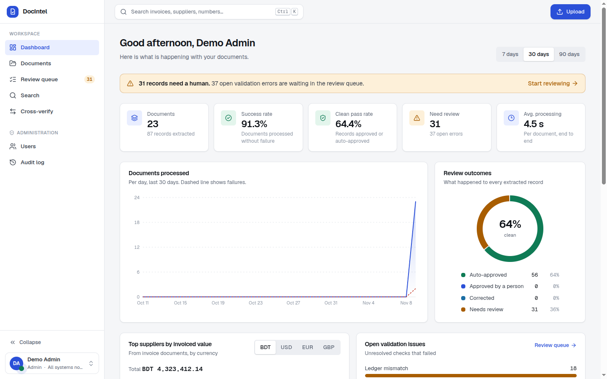

## Features

**Processing**
- PDF (digital, scanned or mixed, any length), JPG, PNG, multi-page TIFF, XLSX (all sheets), XLS and CSV.
- Text-layer extraction for digital PDFs; OCR with deskew, denoise and upscaling for scans and photos.
- Corrupted, empty, encrypted and mislabelled files are rejected with a specific error code instead of failing silently.
- Multi-invoice PDFs are split into individual records; a 1,000-page file is processed in seconds.

**Extraction and validation**
- Invoice number, date, supplier, customer, subtotal, tax, total, currency and line items as JSON.
- Every extracted value is located on the page before it is accepted. A value that cannot be found is stored as
  `null`, never invented, and the rejected candidate is kept for the reviewer.
- Rule engine plus an optional LLM (Anthropic, Gemini, Groq, OpenAI, Ollama or any OpenAI-compatible gateway).
  Agreement raises confidence; disagreement flags the field.
- Checks for missing fields, malformed numbers, duplicate invoices and files, and subtotal, tax, line-item and
  total consistency.
- Cross-verification of invoice documents against another document (PDF to PDF, PDF to Excel) with field-level
  differences.

**Review and search**
- Review workspace with the source page beside the extracted fields; selecting a field highlights its location.
- Inline corrections with re-validation, approval flow, keyboard shortcuts and a full correction history.
- Keyword, semantic and hybrid search with structured filters; export to CSV, Excel or JSON.

**Platform**
- Accounts with three roles (viewer, reviewer, admin), server-side sessions, user management and an audit log.
- Dashboard analytics, bulk actions, light and dark themes, responsive layout.
- AI model, API key and OCR engine configurable from the UI by an administrator; keys are stored encrypted.
- Background workers on a Redis queue, horizontally scalable; one-command Docker deployment.

## Architecture

[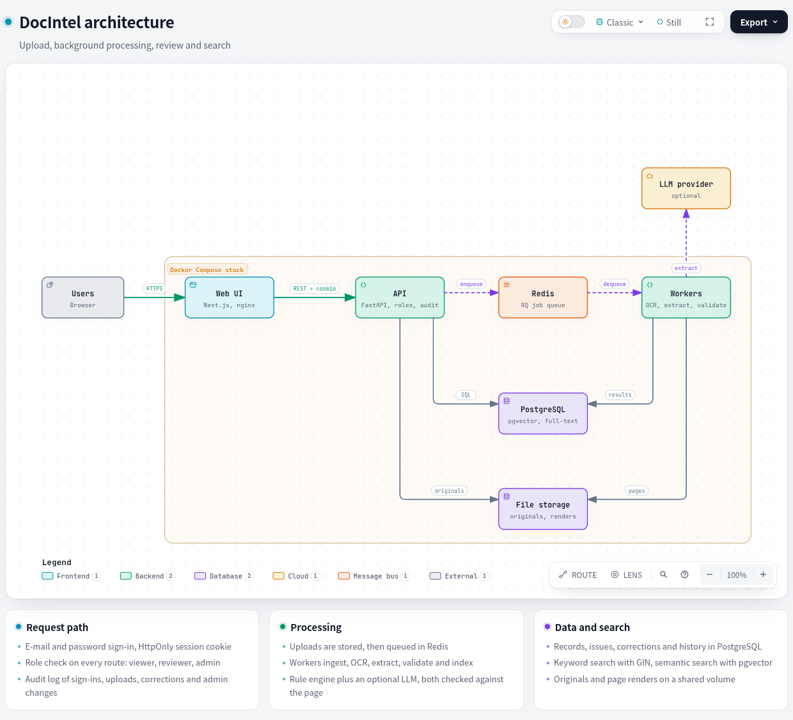](https://rafi0020.github.io/DocIntel/docs/architecture.html)

[Open interactive diagram](https://rafi0020.github.io/DocIntel/docs/architecture.html) · [Architecture notes](docs/ARCHITECTURE.md) · [Database schema](docs/DATABASE.md) · [API reference](docs/API.md)

| Layer | Technology |
|---|---|
| Web UI | Next.js 15 (static export), Tailwind CSS 4, SWR, served by nginx |
| API | FastAPI, SQLAlchemy, Pydantic |
| Queue and workers | Redis, RQ |
| Storage | PostgreSQL 16 with pgvector and pg_trgm; local file volume |
| Document processing | PyMuPDF, Tesseract or RapidOCR, OpenCV, pandas, openpyxl, xlrd |
| Search | PostgreSQL full-text (GIN), `bge-small-en-v1.5` embeddings, Reciprocal Rank Fusion |

## Getting started

### Docker

Requires Docker with Compose v2.

```bash
cp .env.example .env
docker compose up --build
```

- Web UI: http://localhost:3000
- API and interactive docs: http://localhost:8000/docs

Optionally load the sample documents (invoices, scans, ledgers and deliberately broken files):

```bash
python scripts/seed_demo.py
```

### Local development

Requirements: Python 3.12+, Node 22+, PostgreSQL 16 with pgvector, Redis, Tesseract (`apt install tesseract-ocr`).

```bash
# backend
cd backend
pip install -r requirements-dev.txt
cp ../.env.example .env              # set DATABASE_URL and REDIS_URL
uvicorn app.main:app --reload        # API on :8000; creates tables and the demo accounts
python -m app.worker.run --workers 2

# frontend
cd frontend
npm install
NEXT_PUBLIC_API_URL=http://localhost:8000 npm run dev    # UI on :3000
```

### Tests and evaluation

```bash
cd backend
createdb docintel_test && psql docintel_test -c "create extension vector"
pytest -q                            # 138 tests, no Redis required
ruff check .                         # lint

python -m eval.generate_dataset --out ../dataset/synthetic_test --seed 2 --n 60 --batch 40
python -m eval.run_eval --manifest ../dataset/synthetic_test/manifest.json --out ../eval_results/rules/synthetic_test
python -m eval.scale_test --pages 1000 --scan-pages 100
```

The real-invoice split is downloaded from Hugging Face (`katanaml-org/invoices-donut-data-v1`, MIT) and converted
with `eval/prepare_real.py`. Frontend checks: `cd frontend && npx tsc --noEmit && npx eslint src`.
Method, datasets and results are described in [docs/EVALUATION.md](docs/EVALUATION.md).

## Demo accounts

The stack creates three demo accounts on first start when `SEED_DEMO_USERS=true` (the default in this repository).

| Role | E-mail | Password |
|---|---|---|
| Admin | `admin@docintel.demo` | `Admin#Demo2026` |
| Reviewer | `reviewer@docintel.demo` | `Reviewer#Demo2026` |
| Viewer | `viewer@docintel.demo` | `Viewer#Demo2026` |

For any non-demo deployment set `SEED_DEMO_USERS=false`, provide `BOOTSTRAP_ADMIN_EMAIL` and
`BOOTSTRAP_ADMIN_PASSWORD` to create the first administrator, and set `COOKIE_SECURE=true` behind HTTPS.
New accounts created on the sign-up page receive the reviewer role; set `ALLOW_SIGNUP=false` to disable sign-up.

| Role | Read | Upload, correct, approve, re-process, cross-verify | Delete | Users, audit log, model settings |
|---|---|---|---|---|
| Viewer | yes | no | no | no |
| Reviewer | yes | yes | own uploads | no |
| Admin | yes | yes | any | yes |

## Configuration

All settings are environment variables; see [`.env.example`](.env.example).

| Group | Variables |
|---|---|
| LLM | `LLM_PROVIDER`, `LLM_MODEL`, `LLM_API_KEY`, `LLM_BASE_URL` |
| Secrets | `SECRET_KEY` (encrypts API keys saved from the UI; generated if empty) |
| Accounts | `SEED_DEMO_USERS`, `BOOTSTRAP_ADMIN_EMAIL`, `BOOTSTRAP_ADMIN_PASSWORD`, `ALLOW_SIGNUP`, `COOKIE_SECURE`, `SESSION_HOURS`, `REMEMBER_DAYS` |
| Security | `API_KEY` (optional service account), `CORS_ORIGINS`, `MAX_UPLOAD_MB` |
| Processing | `OCR_ENGINE`, `OCR_DPI`, `OCR_THREADS`, `WORKERS`, `AMBIGUOUS_DATE_ORDER` |

### Adding an AI model

DocIntel runs on the rule engine alone by default. A model can be added in either of two ways.

**From the application.** An administrator opens *Settings → Models & API*, selects a provider, enters the API
key and model, runs **Test connection** and saves. The change applies to the next document without a restart.
The key is stored encrypted, is never returned by the API (only its last four characters) and every change is
audited. Documents that were already extracted keep the model they were read with and can be re-processed from
the Documents page.

**From the environment.** The `.env` values act as defaults until settings are saved in the application:

```bash
LLM_PROVIDER=anthropic     # anthropic | gemini | groq | openai | ollama | openai_compatible
LLM_API_KEY=...
LLM_MODEL=claude-haiku-4-5
# openai_compatible also needs LLM_BASE_URL (a gateway such as OpenRouter, vLLM or LiteLLM)
```

For documents that must not leave the network, use `LLM_PROVIDER=ollama` with a local model, or the rule engine alone.

## Screenshots

| | |
|---|---|
| 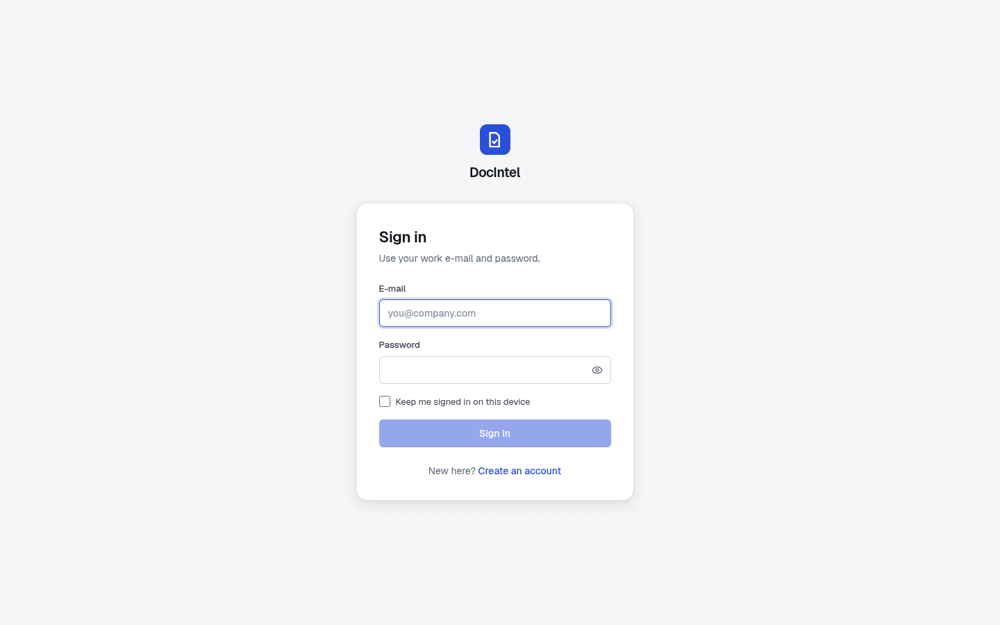 | 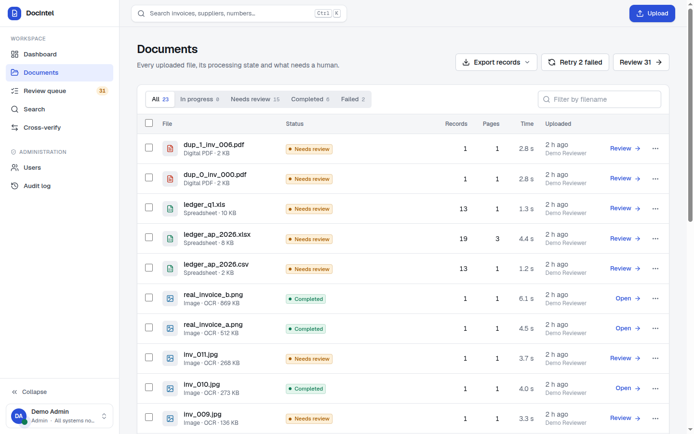 |
| **Sign in** | **Documents**: live progress, bulk actions, export |
| 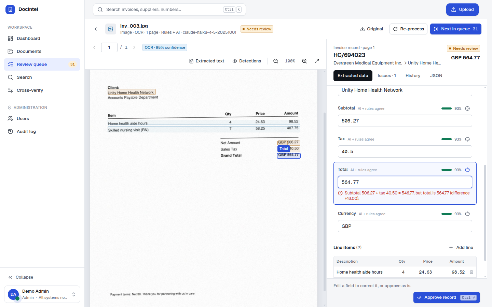 | 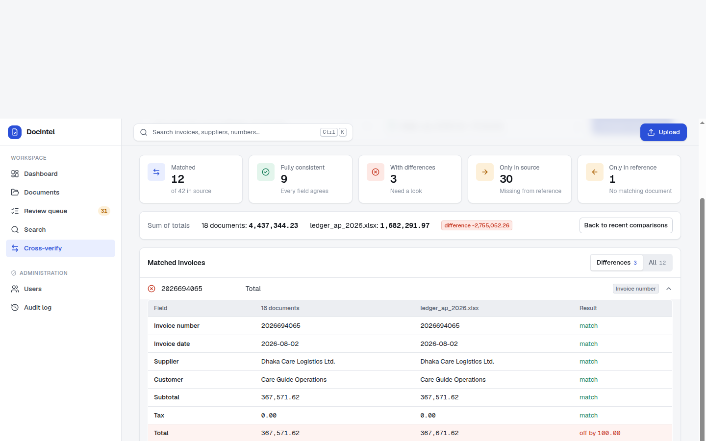 |
| **Review**: the extracted total highlighted on the scan, arithmetic error explained | **Cross-verify**: invoices against a ledger, field-level differences |
| 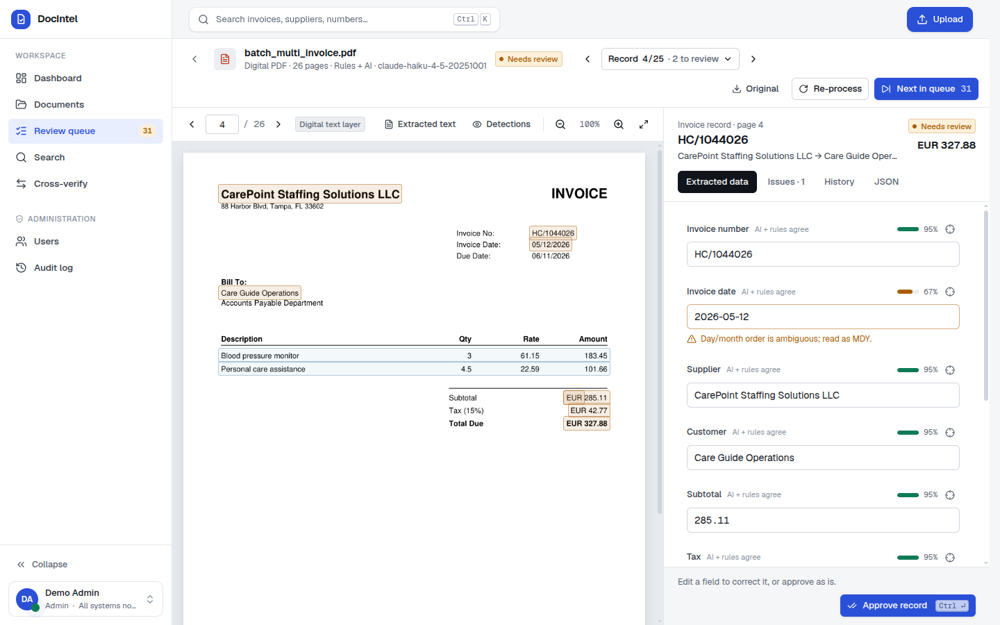 | 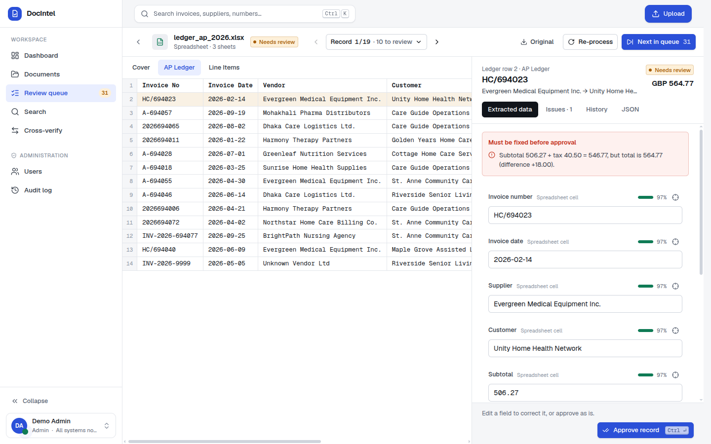 |
| **Batch PDF**: 25 invoices in one file | **Spreadsheet**: cell-level provenance |
| 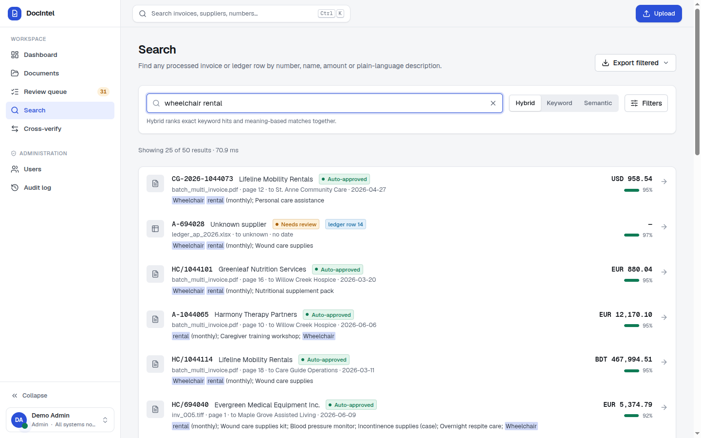 | 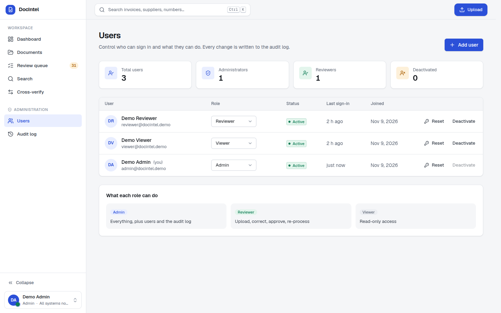 |
| **Search**: hybrid keyword and semantic, filters, export | **Users**: roles, activation, password reset |
| 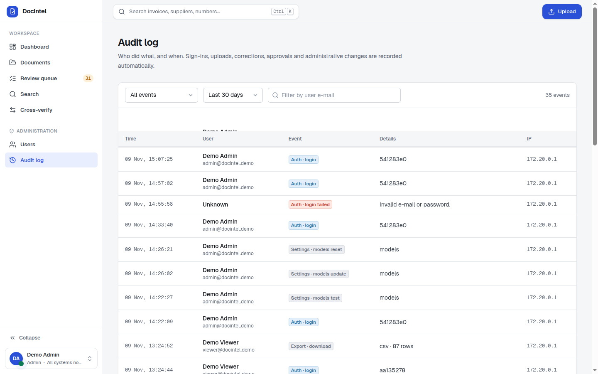 | 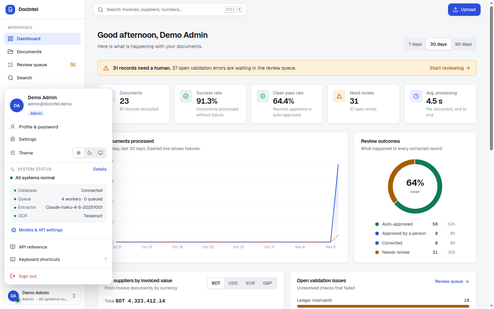 |
| **Audit log**: who did what, and when | **Account card**: profile, theme, live status, shortcuts |
| 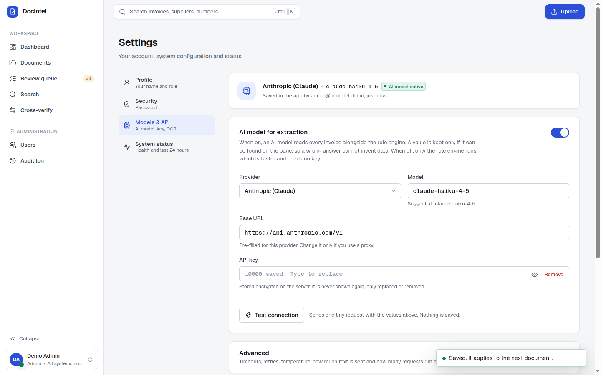 | 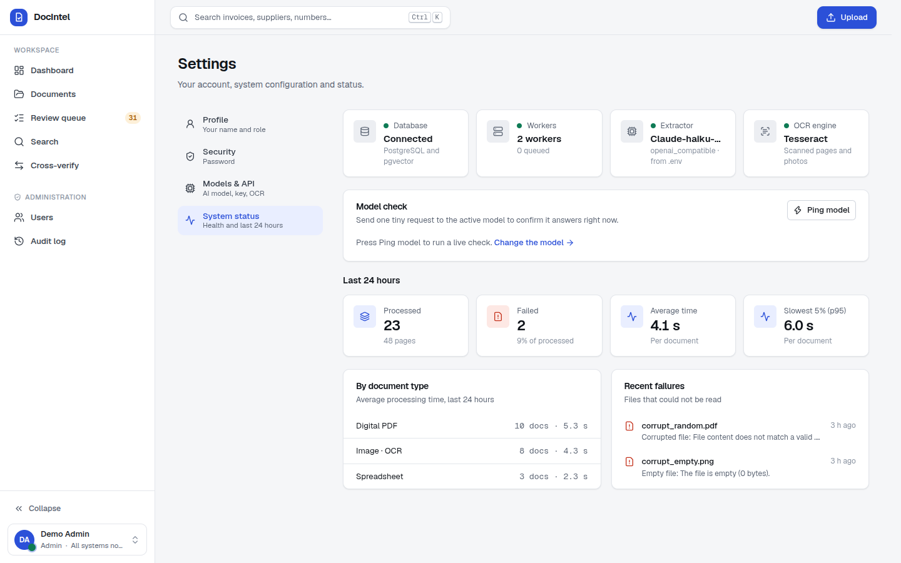 |
| **Models & API**: provider, key, model, connection test | **System status**: health, last 24 hours, recent failures |

## Evaluation

Measured on held-out data with the rule-based extractor and Tesseract (no API key required).

| | Synthetic home-care set | Real invoices (third-party labels) |
|---|---|---|
| Field accuracy (8 fields) | 99.0% | 99.0% |
| Line items F1 | 98.8% | 96.2% |
| Values invented | 0 | 0 |
| Document success rate | 100% (66 valid files) | 100% (26 files) |
| Corrupted files rejected with the correct error code | 6 / 6 | n/a |
| Planted errors caught by validation | 96.7% (29/30) | n/a |
| Wrong ledger entries caught by cross-verification | 11 / 11 | n/a |
| 1,000-page PDF | 3.9 s, 969/969 invoices split and matched | |
| OCR time per scanned page (2 CPU) | 0.53–0.74 s | 1.66 s (large images) |

With a live LLM added (hybrid extraction, `claude-haiku-4-5` through an OpenAI-compatible gateway) field accuracy
is unchanged at 99.0% and no values are invented. Line-item F1 on the real set rises from 96.2% to 99.1% and all
30 planted errors are caught. Median time per file rises from milliseconds to 2.9 s on the synthetic set and from
1.7 s to 5.8 s on the real set, and more clean documents are routed to review (3.8% to 38.5% on the real set)
because any disagreement between the two extractors is flagged. See [docs/EVALUATION.md](docs/EVALUATION.md).

## Security

- Passwords hashed with scrypt; constant-time comparison; account lock-out after repeated failures.
- Server-side sessions in HttpOnly, SameSite cookies; only a hash of the session token is stored.
- `Origin` allow-list check on state-changing requests; CORS restricted to configured origins.
- Role checks enforced on the server for every route; the last active administrator cannot be removed.
- Audit log of sign-ins, uploads, deletions, corrections, approvals, exports and administrative changes.
- Stored API keys encrypted at rest and never returned by the API.
- Upload size and type limits with content sniffing, sanitised filenames, random storage paths, parameterised SQL.
- Document text is treated as untrusted: never rendered as HTML, and the LLM prompt marks it as data with provenance
  checks on every returned value. Exports neutralise spreadsheet formulas.
- Security headers on API and UI; containers run as a non-root user.

Details: [docs/ARCHITECTURE.md](docs/ARCHITECTURE.md#accounts-and-security).

## Documentation

| Document | Contents |
|---|---|
| [docs/ARCHITECTURE.md](docs/ARCHITECTURE.md) | Components, request flow, design decisions, reliability, security, scaling |
| [docs/DATABASE.md](docs/DATABASE.md) | Schema, relationships and indexes |
| [docs/API.md](docs/API.md) | REST endpoints, authentication and result format |
| [docs/EVALUATION.md](docs/EVALUATION.md) | Datasets, metrics, results and failure analysis |
| [docs/PROMPTS.md](docs/PROMPTS.md) | The LLM extraction prompt and the prompts used during development |
| [docs/AI_DISCLOSURE.md](docs/AI_DISCLOSURE.md) | How AI assistance was used in this project |

## Repository layout

```
backend/
  app/
    api/            REST endpoints: documents, invoices, search, analytics, export, accounts, settings
    auth.py         password hashing, sessions, roles, audit helper
    pipeline/       ingestion, OCR, invoice splitting, processing pipeline
    extraction/     rules, LLM providers, prompts, provenance, spreadsheets
    validation/     record rules, duplicate and ledger checks, reconciliation
    search/         embeddings and hybrid search
    worker/         Redis queue and job runner
  eval/             dataset generator, real-set converter, evaluation and scale runners
  tests/            automated tests
frontend/           Next.js UI: sign-in, dashboard, review, administration, settings
docs/               architecture, schema, API, evaluation, prompts, screenshots
eval_results/       raw evaluation output (rules/ and hybrid_llm/)
samples/            demo documents with ground truth
scripts/            demo data loader
docker-compose.yml
```

## License

Released under the [MIT License](LICENSE).
