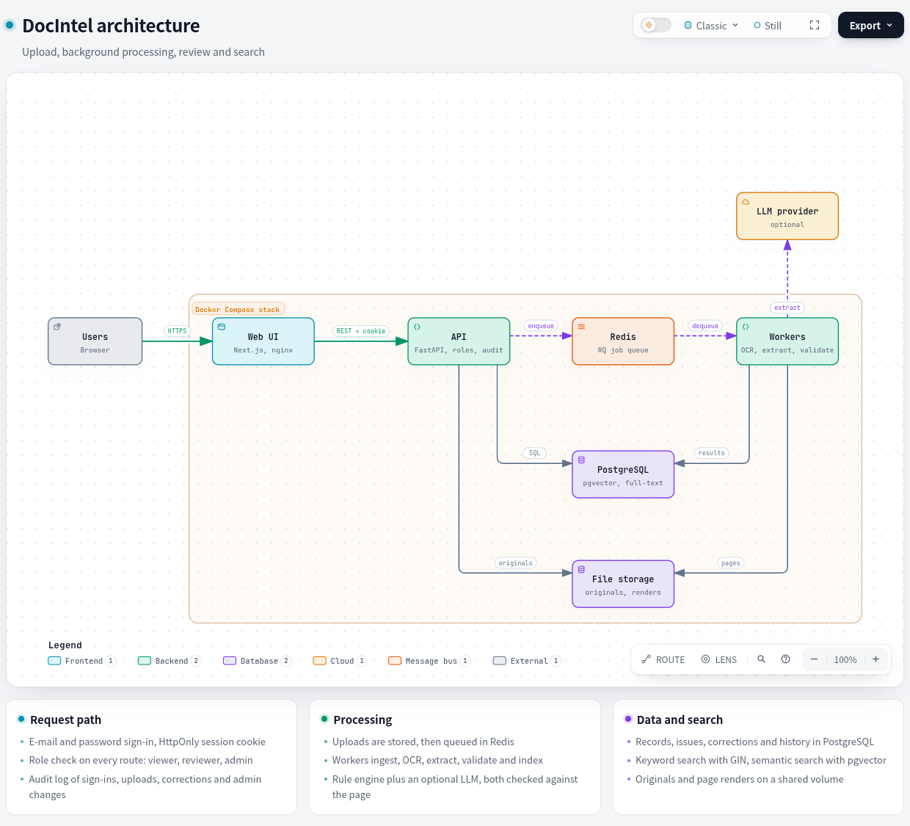
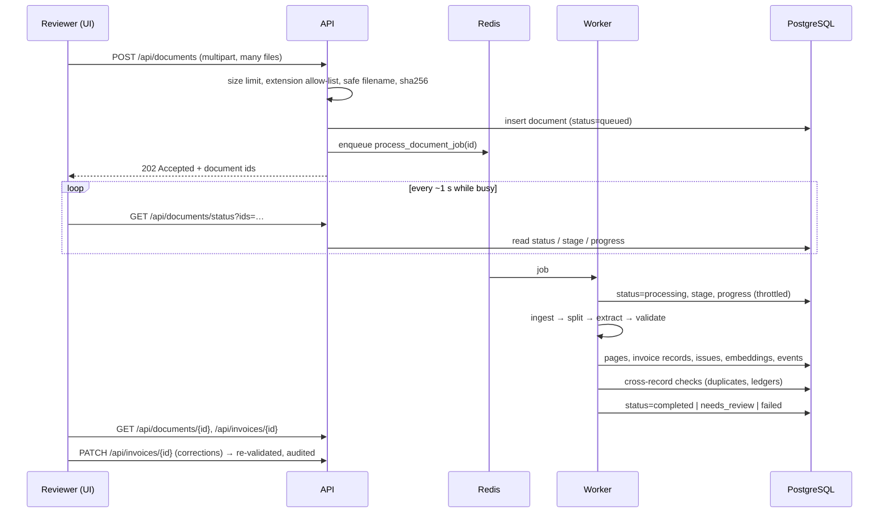

# Architecture

## System overview

The diagram is generated from [`architecture.diagram.json`](architecture.diagram.json); an
[interactive version](architecture.html) is also available.

## Request flow

## Components

| Component | Responsibility | Key files |
|---|---|---|
| **Ingestion** | Detects the real type from magic bytes (not the extension). Digital PDF pages use the text layer with word boxes; pages with no text layer are rendered and OCR'd (mixed PDFs work page by page). Images and multi-frame TIFFs are OCR'd after clean-up (upscale, deskew, denoise, contrast). Every sheet of XLSX/XLS/CSV becomes a grid. Corrupted, empty, encrypted or unreadable files fail with a stable error code; a single bad page does not fail the document. | `pipeline/ingest.py`, `pipeline/ocr.py` |
| **Splitting** | A large PDF (e.g. a 1,000-page batch) is split into invoices by invoice-number changes and "Page 1 of N" markers. Deterministic and linear in page count. | `pipeline/segment.py` |
| **Extraction** | Two extractors run on each invoice: a label-driven rule engine (always) and an LLM (when configured). Every candidate value must be **found in the document text** before it is accepted (provenance); the match also yields the bounding box the UI highlights. Agreement raises confidence, disagreement flags the field, an unverifiable value becomes `null` with the rejected candidate kept for the reviewer. Ledger spreadsheets map columns by header synonyms and keep cell addresses as provenance. | `extraction/*.py` |
| **Validation** | Per record: missing/unparseable fields, numeric sanity, subtotal + tax = total, Σ line items = subtotal, qty × price = amount, dates, low confidence, extractor disagreement. Across records: duplicate invoices and files, possible duplicates (same supplier/date/total), and document ↔ ledger cross-checks. | `validation/rules.py`, `validation/cross.py` |
| **Cross-verification** | Matches the invoices of one or many documents to another document (PDF↔PDF, PDF↔Excel): exact number, then OCR-aware number matching, then supplier + total + date; reports field and line-item differences with hints (digit transposition, misplaced decimal, rounding). | `validation/reconcile.py` |
| **Search** | Keyword: PostgreSQL full-text search on a generated `tsvector` (GIN index) plus trigram/ILIKE for partial numbers and names. Semantic: local `bge-small-en-v1.5` embeddings in pgvector. Hybrid (default): Reciprocal Rank Fusion of both. All modes take the same filters. | `search/*.py` |
| **API** | REST endpoints, accounts and roles, audit log, upload hygiene, security headers, OpenAPI docs at `/docs`. | `api/*.py`, `auth.py`, `security.py` |
| **Worker** | RQ `SimpleWorker` processes: models stay warm in each process, retries with back-off for unexpected errors, no retry for deterministic file errors. | `worker/*.py` |
| **UI** | Dashboard, documents with live progress and bulk actions, review workspace (page viewer with click-to-source highlights, editable fields and line items, issues, history, JSON), review queue, cross-verify, search, administration and settings, quick find. | `frontend/src` |

## Design decisions

**One Python service instead of NestJS + Python.** OCR, PDF parsing, pandas and the LLM calls are all Python. A Node API in front would add a second runtime, a second set of models for the same data and an RPC hop, with no capability gained. FastAPI gives typed request validation and OpenAPI docs for free.

**Redis + RQ instead of BullMQ.** Same pattern (durable Redis-backed jobs, retries, back-off, timeouts) in the language the jobs are written in. Jobs survive API restarts: files uploaded while no worker is running are processed when one starts. Scaling is horizontal: `WORKERS=n` or more worker containers.

**pgvector instead of a separate vector database.** Records, full-text index and embeddings live in one transactional store, so a correction updates all three atomically and semantic search can use the same SQL filters as keyword search. At this data size (millions of rows), pgvector is more than enough; a dedicated vector store is a later optimisation, not a starting point.

**Tesseract by default, RapidOCR optional.** Measured on the held-out synthetic split with the same extractor: Tesseract 99.0% field accuracy vs RapidOCR 86.9% (on degraded scans 100% vs 50% for medium quality, 89% vs 36% for poor), at 0.6–0.7 s vs 2.0–3.0 s per page. RapidOCR's default PP-OCR model is a Chinese/English model that drops the spaces between English words ("UnityHomeHealthNetwork"). Both engines sit behind `OCR_ENGINE`; see `docs/EVALUATION.md`.

**Rules + LLM, both checked against the page.** The LLM handles layouts the rules never saw; the rules give a free, deterministic second opinion and a fallback when the LLM is down or not configured. The provenance check is what makes "do not invent values" a guarantee instead of a prompt instruction: a value that is not on the page is never stored.

**Local LLM option for sensitive documents.** Home-care invoices can contain patient names. With `LLM_PROVIDER=ollama` no document leaves the network; the rule engine alone also works fully offline.

**Static Next.js export.** The UI is plain files served by nginx; there is no Node server in production, which removes a runtime and an attack surface.

## Reliability and failure handling

| Failure | Behaviour |
|---|---|
| Corrupted / empty / encrypted / unsupported file | Fails immediately with a code (`corrupted_file`, `empty_file`, `encrypted_pdf`, `unsupported_type`, `no_text_found`); visible in the inbox; no retry |
| One unreadable page in a long PDF | Page recorded with its error; rest of the document processed |
| LLM timeout / 429 / 5xx | Retries with exponential back-off; then falls back to the rule engine and records an `llm_fallback` note |
| LLM returns invalid JSON | One repair request; then fallback |
| Unexpected worker crash | Document marked failed with the error; RQ retries (2×, 10 s / 60 s back-off); `POST /api/documents/reprocess-failed` re-queues all |
| Worker restarts | Jobs wait in Redis and resume |
| Same file / invoice uploaded twice | Accepted, flagged as `duplicate_file` / `duplicate_invoice` |

## Accounts and security

**Accounts.** Users sign in with e-mail and password (or sign up, which creates a `reviewer`). Three roles:
`viewer` (read), `reviewer` (upload, correct, approve, re-process, cross-verify), `admin` (plus users and the
audit log). The data is a **shared team workspace**: everyone signed in can see every document, and the system
records who uploaded, corrected and approved each one. Reviewers can delete only their own uploads.

| Concern | Decision |
|---|---|
| Passwords | scrypt (standard library, memory-hard) with a per-user salt; constant-time comparison; unknown e-mails still pay the hashing cost so timing does not reveal which accounts exist. Minimum 10 characters with a letter and a number. |
| Sessions | A random 256-bit token in an **HttpOnly, SameSite=Lax** cookie (`Secure` when `COOKIE_SECURE=true`); only its SHA-256 hash is stored. Server-side sessions can be revoked: logout, password change and deactivation take effect immediately (a self-contained JWT could not do this). |
| CSRF | SameSite plus an `Origin` allow-list check on every state-changing cookie request. |
| Brute force | Five wrong passwords lock the account for ten minutes; failures are audited. |
| Authorisation | Role checks are FastAPI dependencies on every route (`need("reviewer")`), so a missing check fails closed. The last active admin cannot be demoted or deactivated. |
| Audit | `audit_log` records sign-ins (and failures), signups, uploads, deletes, re-processing, corrections, approvals, comparisons, exports and every user-admin action, with user, IP and details. Corrections store the **signed-in** user, never a name supplied by the client. |
| Service account | Optional `API_KEY` (`X-API-Key`) for scripts, with reviewer rights only. |
| Stored API keys | Encrypted at rest with a server-side master secret; write-only through the API; changes audited without the key. Rotating the secret makes saved keys unreadable and the UI asks for them again. |
| Demo accounts | `SEED_DEMO_USERS=true` creates one account per role on first start for evaluation. Turn it off for a real deployment. |

**Model settings from the UI.** An administrator can choose the provider, model, base URL, API key and OCR
engine under *Settings → Models & API*. They are stored in `app_settings`; the API key is encrypted with Fernet
(AES with an HMAC) using a master secret from `SECRET_KEY`, or one generated once into the data volume. The key is
never returned by any endpoint, never logged and only ever shown as its last four characters. The `.env` values are
the defaults until something is saved; a saved configuration overrides them, and workers re-read it per job (cached
for 5 seconds), so a change applies to the next document without a restart. Records keep the extractor they were
read with.

**Everything else.**
- Upload hygiene: size limit, per-request file limit, extension allow-list, content sniffing (a renamed file is detected), sanitised filenames, files stored under random UUID paths (no user-controlled paths).
- All SQL through SQLAlchemy parameters; search input goes through `websearch_to_tsquery`.
- Document text is untrusted: search highlights use sentinel markers rendered as React nodes, never `innerHTML`; the LLM prompt marks the document as data and LLM output is schema-checked and provenance-checked, so injected instructions cannot place values that are not on the page. Exports neutralise spreadsheet formulas.
- Security headers on API and UI; CORS restricted to configured origins (with credentials); containers run as a non-root user.
- Not built (see README): SSO/MFA, rate limiting beyond account lock-out, encryption at rest, virus scanning, per-team data isolation; listed with how they would be added.

## Scaling path

| Load | What to change |
|---|---|
| More documents per hour | Add worker containers (`docker compose up --scale worker=N`); OCR is CPU-bound and parallel per page (`OCR_THREADS`) |
| Very large PDFs | Already streamed page by page; for 10k+ pages split into page-range jobs |
| LLM cost/latency | `LLM_CONCURRENCY`, cheaper model, or only call the LLM when rule confidence is low |
| Search volume | HNSW index on `invoices.embedding`; read replica |
| Storage | Swap the local volume for S3-compatible storage (single module) |
