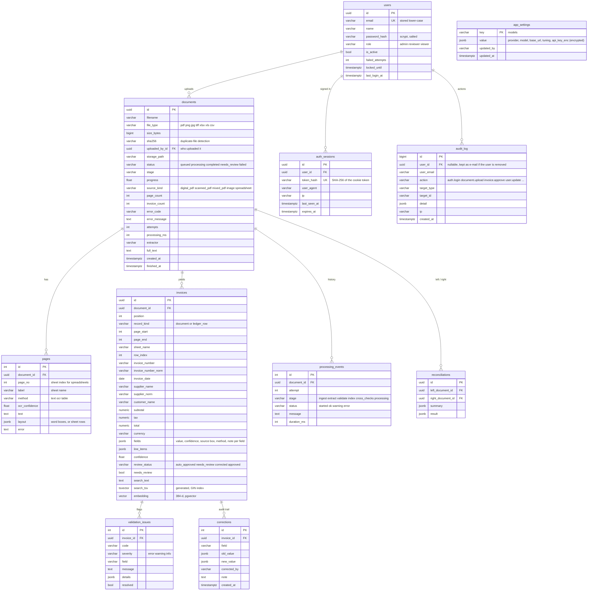

# Database schema

PostgreSQL 16 with the `vector` (pgvector) and `pg_trgm` extensions. Tables are created by
`app/db.py:init_db()` from the SQLAlchemy models in `app/models.py`.

## Why it is shaped this way

- **`documents` vs `invoices`.** One upload can hold many invoices (a 1,000-page batch, a ledger with hundreds of rows), so extracted records are their own table. `record_kind` separates invoice documents from ledger rows: duplicates are checked within a kind, and the two kinds are cross-checked against each other.
- **Typed columns and a JSON `fields` column.** Number, date, parties and amounts are real columns (indexed, filterable, sortable, `numeric(18,2)` for money). The full per-field result (confidence, bounding box or cell address, which extractor, notes, rejected candidates) lives in `fields` so the UI can explain every value without schema churn.
- **Normalised keys.** `invoice_number_norm` (alphanumerics, upper case) and `supplier_norm` (no punctuation or company suffixes) drive duplicate detection and cross-checks.
- **Search columns.** `search_tsv` is a *generated* column, so it can never drift from `search_text`; it has a GIN index. A trigram index on `supplier_name` serves partial name matches. `embedding` is a pgvector column for semantic search.
- **Audit trail.** Corrections are append-only with old and new values, the reviewer and an optional note; approvals are recorded there too. `processing_events` keeps per-attempt, per-stage timings and errors, which is what the History tab and the evaluation's timing figures come from.

- **Accounts.** `users`, `auth_sessions` and `audit_log` are separate from the document tables. Only a hash of the session token is stored, so a database leak does not hand out live sessions. `audit_log` keeps the e-mail and name next to the (nullable) user id so history survives a user being removed. `app_settings` holds runtime configuration edited from the UI; the API key inside it is stored encrypted, never in plain text. Existing databases gain `documents.uploaded_by_id` automatically at start-up.

## Indexes

| Index | Purpose |
|---|---|
| `documents(status)`, `documents(sha256)` | Inbox filters, duplicate-file check |
| `invoices(document_id)`, `(invoice_number)`, `(invoice_number_norm)`, `(supplier_norm)`, `(invoice_date)`, `(total)`, `(review_status)`, `(needs_review)` | Filters, duplicate and ledger cross-checks |
| `invoices USING gin(search_tsv)` | Keyword search |
| `invoices USING gin(supplier_name gin_trgm_ops)` | Partial supplier matching |
| `validation_issues(invoice_id)`, `(code)` | Review queue, "has issue" filter |
| `users(email)` unique, `auth_sessions(token_hash)` unique, `auth_sessions(expires_at)`, `audit_log(created_at)`, `(action)`, `(user_id)`, `documents(uploaded_by_id)` | Sign-in, session lookup and clean-up, audit filters |
| `pages(document_id)`, `corrections(invoice_id)`, `processing_events(document_id)` | Detail views |

At larger scale, add an HNSW index on `invoices.embedding` (`vector_cosine_ops`) for approximate nearest-neighbour search.
